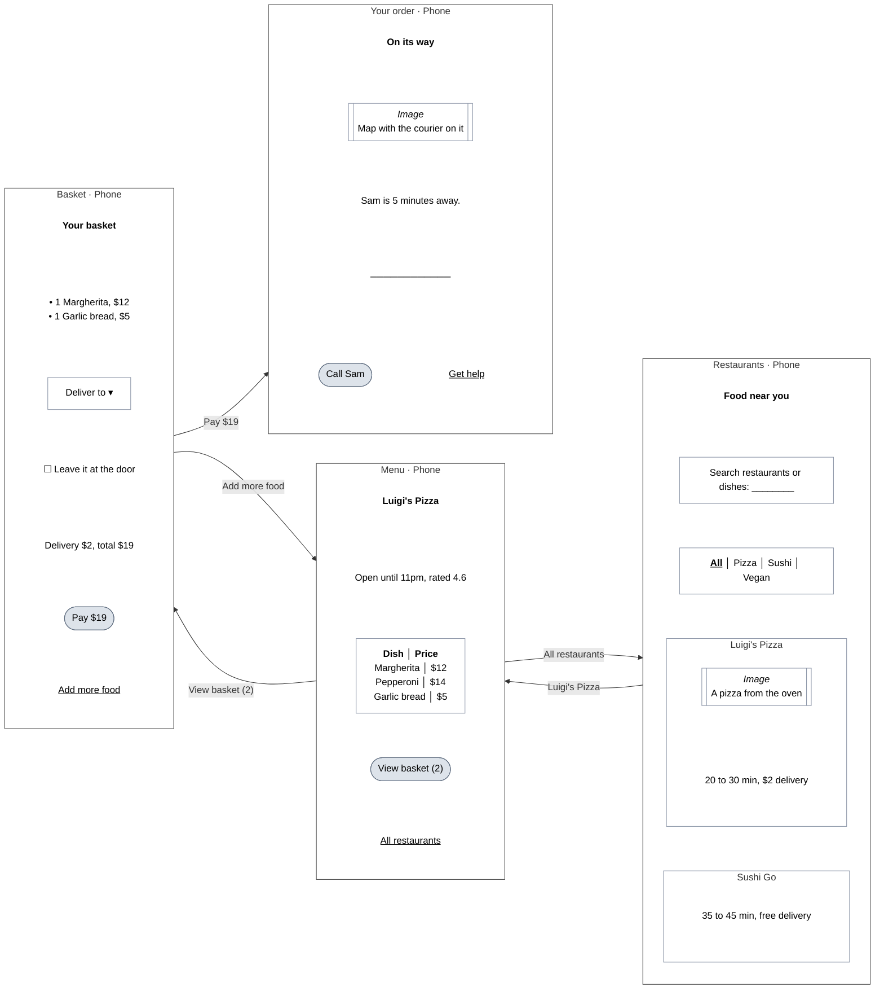

<!-- Generated by open-arch from food-delivery.openarch. Don't edit: change the model in the designer or with the open-arch CLI, and this page is rewritten. -->

# 7. Customer App screens

Wireframe view of [Customer App](../elements/customer-app.md).

What a customer taps through to order food, from finding a restaurant to tracking the courier.

## Sticky notes

> A wireframe view sketches an app's screens: what's on each one, and where tapping a button or link takes you. This one is the Customer App, a container from view 3.
>
> It isn't one of C4's levels of zoom, but it's drawn for a container of the model. Select the Customer App and use Find usages in its details to find it.

> Read an arrow as a tap: Pay $19 on the Basket screen opens Your order. Click a widget to see the screen it leads to in its details.

> Keep wireframes rough: grey boxes and short labels, not colours and fonts. They're for agreeing what goes on each screen before anyone designs it.

> Your turn! Select a screen and use + Add to put a widget on it, or drag a widget to another screen. Drag from the dot beside a widget to a screen to make it lead there.

## Screens

### 1. Restaurants

Phone screen. The first screen: restaurants that deliver here.

| # | Widget | Text | Leads to | Description |
|---|---|---|---|---|
| 1 | Heading | Food near you |  |  |
| 2 | Text field | Search restaurants or dishes |  |  |
| 3 | Tabs | All / Pizza / Sushi / Vegan |  |  |
| 4 | Panel | Luigi's Pizza | Menu | Tapping anywhere on a restaurant opens its menu. |
| 4.1 | Image | A pizza from the oven |  |  |
| 4.2 | Text | 20 to 30 min, $2 delivery |  |  |
| 5 | Panel | Sushi Go |  |  |
| 5.1 | Text | 35 to 45 min, free delivery |  |  |

### 2. Menu

Phone screen. One restaurant's dishes.

| # | Widget | Text | Leads to | Description |
|---|---|---|---|---|
| 1 | Heading | Luigi's Pizza |  |  |
| 2 | Text | Open until 11pm, rated 4.6 |  |  |
| 3 | Table | Dish \| Price / Margherita \| $12 / Pepperoni \| $14 / Garlic bread \| $5 |  | Tapping a dish adds it to the basket. |
| 4 | Button | View basket (2) | Basket |  |
| 5 | Link | All restaurants | Restaurants |  |

### 3. Basket

Phone screen. What's about to be ordered, and where it goes.

| # | Widget | Text | Leads to | Description |
|---|---|---|---|---|
| 1 | Heading | Your basket |  |  |
| 2 | List | 1 Margherita, $12 / 1 Garlic bread, $5 |  |  |
| 3 | Drop-down | Deliver to |  |  |
| 4 | Checkbox | Leave it at the door |  |  |
| 5 | Text | Delivery $2, total $19 |  |  |
| 6 | Button | Pay $19 | Your order | Places the order: the Order API charges the card through the Payment Provider. |
| 7 | Link | Add more food | Menu |  |

### 4. Your order

Phone screen. Where the food is, until it arrives.

| # | Widget | Text | Leads to | Description |
|---|---|---|---|---|
| 1 | Heading | On its way |  |  |
| 2 | Image | Map with the courier on it |  | The courier's position comes from the Courier App, through the Order API. |
| 3 | Text | Sam is 5 minutes away. |  |  |
| 4 | Divider |  |  |  |
| 5 | Row |  |  |  |
| 5.1 | Button | Call Sam |  |  |
| 5.2 | Link | Get help |  | Opens a chat with a support agent, who uses the Support Desk. |

[All views and elements](../README.md)
