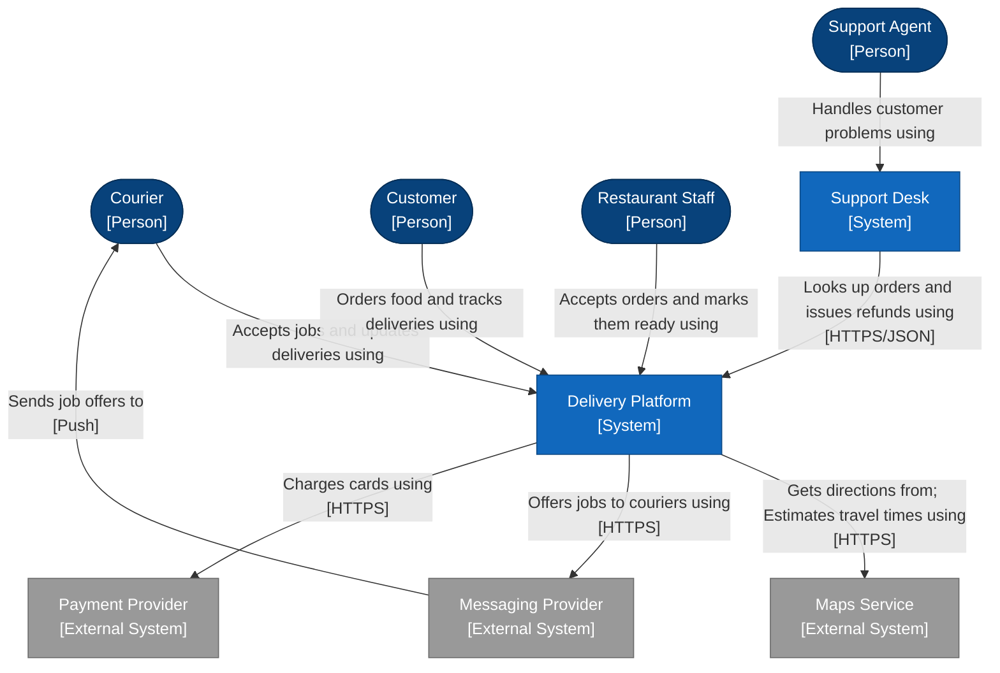

<!-- Generated by open-arch from food-delivery.openarch. Don't edit: change the model in the designer or with the open-arch CLI, and this page is rewritten. -->

# 1. System landscape

Landscape view.

Every person and system in the business, and how they connect.

## Sticky notes

> Welcome! This example teaches you to read architecture diagrams drawn with the C4 model, using a made-up food delivery business.
>
> Open views 1 to 6 under Views, in order. Views 1 to 5 each zoom in a step, down to the code.

> This is a landscape view: every person and system in the model, and how they connect. It's the map of the whole business.
>
> Click any box to read about it in its details.

> The boxes with rounded tops are people: roles like Customer or Courier, not named individuals.

> The square blue boxes are software systems. A system is something one team owns that does a job for people, like the Delivery Platform.

> Read an arrow as a sentence: Support Agent → handles customer problems using → Support Desk.
>
> Dashed arrows stand for arrows between the parts inside the boxes. View 3 explains.

> Grey boxes are external: run by another company. You show how you use them, never what's inside them.

## Elements

| Element | Kind | Technology | Description |
|---|---|---|---|
| [Courier](../elements/courier.md) | Person |  | Collects orders from restaurants and delivers them. |
| [Customer](../elements/customer.md) | Person |  | Orders food from local restaurants. |
| [Restaurant Staff](../elements/restaurant-staff.md) | Person |  | Accepts orders and gets them ready for pickup. |
| [Support Agent](../elements/support-agent.md) | Person |  | Sorts out problems with orders. |
| [Delivery Platform](../elements/delivery-platform.md) | System |  | Lets customers order food, restaurants prepare it and couriers deliver it. |
| [Maps Service](../elements/maps-service.md) | External System |  | Provides maps, directions and travel times. |
| [Messaging Provider](../elements/messaging-provider.md) | External System |  | Sends push notifications and text messages. |
| [Payment Provider](../elements/payment-provider.md) | External System |  | Takes card payments. |
| [Support Desk](../elements/support-desk.md) | System |  | Tracks customer problems and refunds. |

## Relationships

| From | To | Description | Technology |
|---|---|---|---|
| [Courier](../elements/courier.md) | [Delivery Platform](../elements/delivery-platform.md) | Accepts jobs and updates deliveries using |  |
| [Customer](../elements/customer.md) | [Delivery Platform](../elements/delivery-platform.md) | Orders food and tracks deliveries using |  |
| [Delivery Platform](../elements/delivery-platform.md) | [Maps Service](../elements/maps-service.md) | Gets directions from; Estimates travel times using | HTTPS |
| [Delivery Platform](../elements/delivery-platform.md) | [Messaging Provider](../elements/messaging-provider.md) | Offers jobs to couriers using | HTTPS |
| [Delivery Platform](../elements/delivery-platform.md) | [Payment Provider](../elements/payment-provider.md) | Charges cards using | HTTPS |
| [Messaging Provider](../elements/messaging-provider.md) | [Courier](../elements/courier.md) | Sends job offers to | Push |
| [Restaurant Staff](../elements/restaurant-staff.md) | [Delivery Platform](../elements/delivery-platform.md) | Accepts orders and marks them ready using |  |
| [Support Agent](../elements/support-agent.md) | [Support Desk](../elements/support-desk.md) | Handles customer problems using |  |
| [Support Desk](../elements/support-desk.md) | [Delivery Platform](../elements/delivery-platform.md) | Looks up orders and issues refunds using | HTTPS/JSON |

[All views and elements](../README.md)
