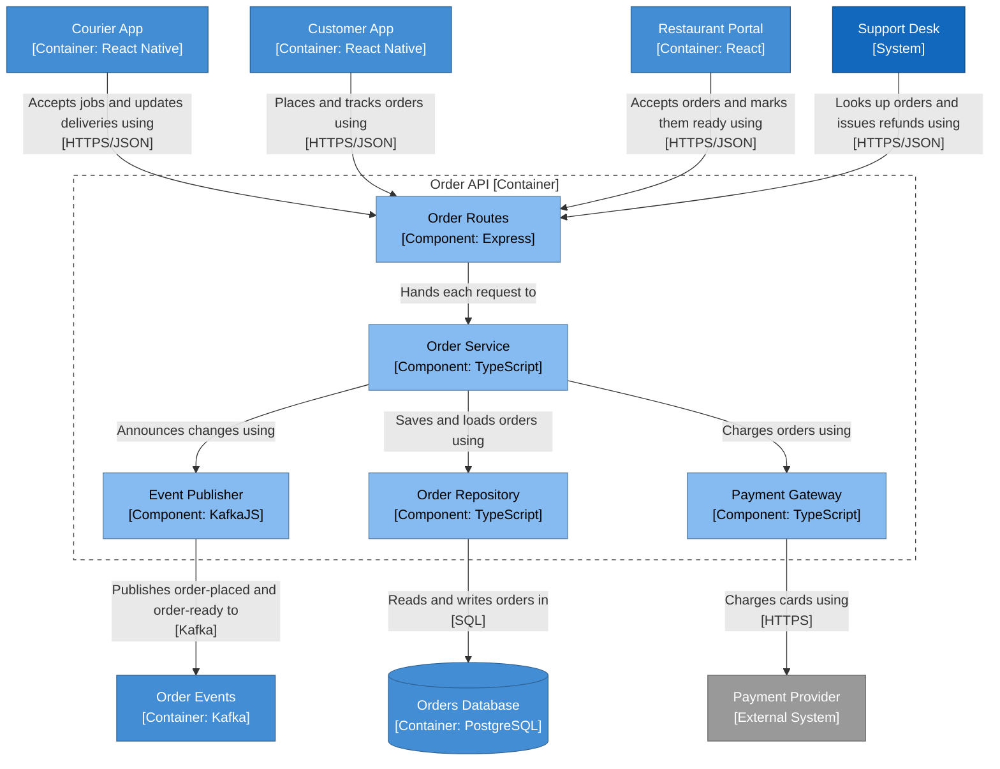

<!-- Generated by open-arch from food-delivery.openarch. Don't edit: change the model in the designer or with the open-arch CLI, and this page is rewritten. -->

# 4. Order API components

Component view of [Order API](../elements/order-api.md).

How the Order API handles an order.

## Notes

> A component view looks inside one container. Components are the big building blocks of its code, such as modules or services.
>
> Only draw them when they help explain something.

> Outside the frame are the other containers and systems these components talk to. The people aren't here: they use the apps, not these components.

> Each relationship is modelled once, on the most detailed element. Views 1 to 3 draw the same relationships at their own zoom level, so the views never disagree.

## Elements

| Element | Kind | Technology | Description |
|---|---|---|---|
| [Payment Provider](../elements/payment-provider.md) | External System |  | Takes card payments. |
| [Support Desk](../elements/support-desk.md) | System |  | Tracks customer problems and refunds. |
| [Courier App](../elements/courier-app.md) | Container | React Native | Shows couriers their jobs and the way there. |
| [Customer App](../elements/customer-app.md) | Container | React Native | Lets customers browse menus, order and track their food. |
| [Order Events](../elements/order-events.md) | Container | Kafka | Carries events like order-placed and order-ready. |
| [Orders Database](../elements/orders-db.md) | Container | PostgreSQL | Stores orders, menus and deliveries. |
| [Restaurant Portal](../elements/restaurant-portal.md) | Container | React | Lets restaurants manage menus and incoming orders. |
| [Event Publisher](../elements/event-publisher.md) | Component | KafkaJS | Publishes order events. |
| [Order Repository](../elements/order-repository.md) | Component | TypeScript | Reads and writes orders. |
| [Order Routes](../elements/order-routes.md) | Component | Express | Receives requests from the apps, the portal and the support desk. |
| [Order Service](../elements/order-service.md) | Component | TypeScript | Applies the ordering rules: prices, payment and each order's status. |
| [Payment Gateway](../elements/payment-gateway.md) | Component | TypeScript | Wraps the payment provider's API. |

## Relationships

| From | To | Description | Technology |
|---|---|---|---|
| [Courier App](../elements/courier-app.md) | [Order Routes](../elements/order-routes.md) | Accepts jobs and updates deliveries using | HTTPS/JSON |
| [Customer App](../elements/customer-app.md) | [Order Routes](../elements/order-routes.md) | Places and tracks orders using | HTTPS/JSON |
| [Event Publisher](../elements/event-publisher.md) | [Order Events](../elements/order-events.md) | Publishes order-placed and order-ready to | Kafka |
| [Order Repository](../elements/order-repository.md) | [Orders Database](../elements/orders-db.md) | Reads and writes orders in | SQL |
| [Order Routes](../elements/order-routes.md) | [Order Service](../elements/order-service.md) | Hands each request to |  |
| [Order Service](../elements/order-service.md) | [Event Publisher](../elements/event-publisher.md) | Announces changes using |  |
| [Order Service](../elements/order-service.md) | [Order Repository](../elements/order-repository.md) | Saves and loads orders using |  |
| [Order Service](../elements/order-service.md) | [Payment Gateway](../elements/payment-gateway.md) | Charges orders using |  |
| [Payment Gateway](../elements/payment-gateway.md) | [Payment Provider](../elements/payment-provider.md) | Charges cards using | HTTPS |
| [Restaurant Portal](../elements/restaurant-portal.md) | [Order Routes](../elements/order-routes.md) | Accepts orders and marks them ready using | HTTPS/JSON |
| [Support Desk](../elements/support-desk.md) | [Order Routes](../elements/order-routes.md) | Looks up orders and issues refunds using | HTTPS/JSON |

[All views and elements](../README.md)
