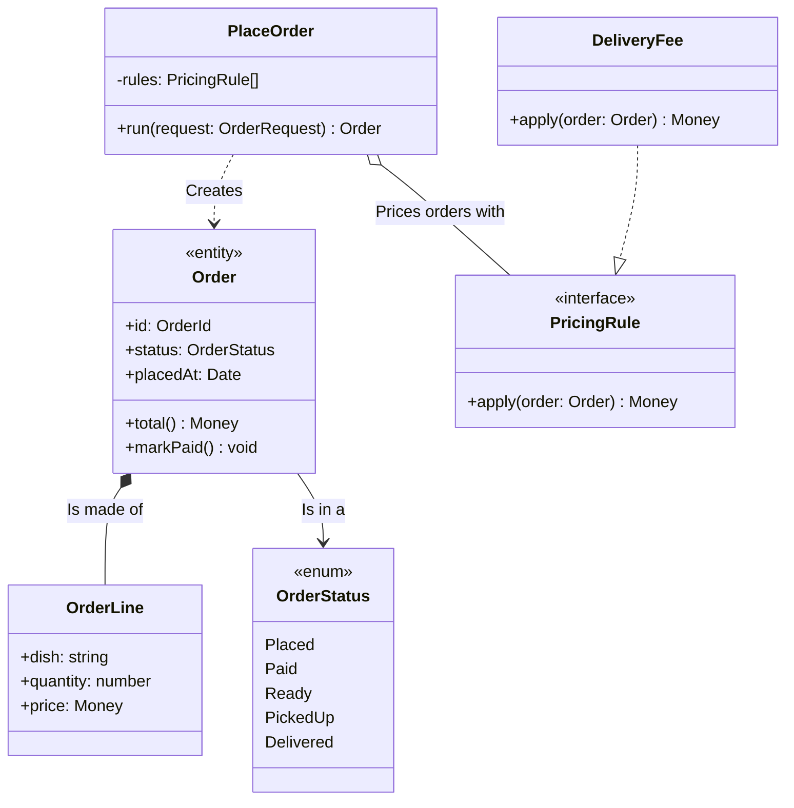

<!-- Generated by open-arch from food-delivery.openarch. Don't edit: change the model in the designer or with the open-arch CLI, and this page is rewritten. -->

# 5. Order Service classes

Class view of [Order Service](../elements/order-service.md).

The code inside the Order Service: its classes, and how they relate.

## Sticky notes

> A class view looks inside one component at its code. It's C4's fourth and last level, drawn as a UML class diagram: each box is a class, with its attributes and then its methods.

> The ends of an arrow say how two classes relate. A hollow triangle extends another class, or implements it when the line is dashed. A filled diamond is made of the other class, a hollow one holds it, and a dashed open arrow depends on it.

> Draw code only where it explains something tricky. It changes far more often than the views above, so these diagrams go out of date first.

## Elements

| Element | Kind | Technology | Description |
|---|---|---|---|
| [DeliveryFee](../elements/delivery-fee.md) | Class |  | Charges more the further the courier rides. |
| [Order](../elements/order.md) | Class |  | One customer's order, from placing it to delivery. |
| [OrderLine](../elements/order-line.md) | Class |  | A dish and how many of it. |
| [OrderStatus](../elements/order-status.md) | Class |  |  |
| [PlaceOrder](../elements/place-order.md) | Class |  | Turns a customer's request into a priced order. |
| [PricingRule](../elements/pricing-rule.md) | Class |  | One way an order's price is worked out. |

## Relationships

| From | To | Description | Technology |
|---|---|---|---|
| [DeliveryFee](../elements/delivery-fee.md) | [PricingRule](../elements/pricing-rule.md) | (realization) |  |
| [Order](../elements/order.md) | [OrderLine](../elements/order-line.md) | (composition) Is made of |  |
| [Order](../elements/order.md) | [OrderStatus](../elements/order-status.md) | Is in a |  |
| [PlaceOrder](../elements/place-order.md) | [Order](../elements/order.md) | (dependency) Creates |  |
| [PlaceOrder](../elements/place-order.md) | [PricingRule](../elements/pricing-rule.md) | (aggregation) Prices orders with |  |

[All views and elements](../README.md)
