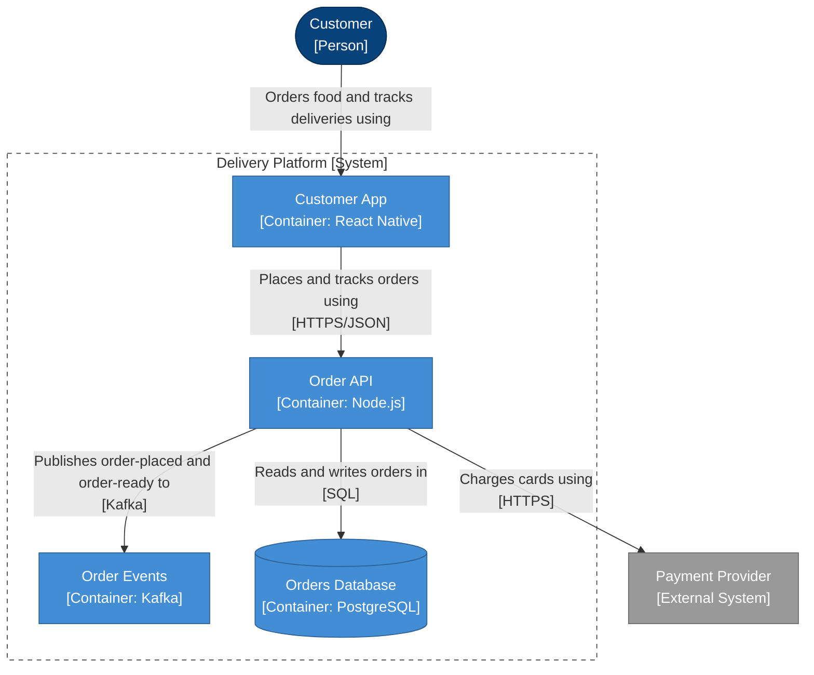

<!-- Generated by open-arch from food-delivery.openarch. Don't edit: change the model in the designer or with the open-arch CLI, and this page is rewritten. -->

# 5. Placing an order

Container view of [Delivery Platform](../elements/delivery-platform.md).

Only what's involved when a customer places an order.

## Notes

> Views don't copy the model, they pick from it. This one lists exactly which elements to show (its include list), so it tells one story: placing an order.

> Rename a box here and it changes in every view, because there's only one model underneath.

> Your turn! Use + Add to add a container or a sticky note, drag from the dot under a box to another box to draw an arrow, and double-click a note to edit it. Undo takes anything back.

## Elements

| Element | Kind | Technology | Description |
|---|---|---|---|
| [Customer](../elements/customer.md) | Person |  | Orders food from local restaurants. |
| [Payment Provider](../elements/payment-provider.md) | External System |  | Takes card payments. |
| [Customer App](../elements/customer-app.md) | Container | React Native | Lets customers browse menus, order and track their food. |
| [Order API](../elements/order-api.md) | Container | Node.js | Takes orders, charges for them and tracks their progress. |
| [Order Events](../elements/order-events.md) | Container | Kafka | Carries events like order-placed and order-ready. |
| [Orders Database](../elements/orders-db.md) | Container | PostgreSQL | Stores orders, menus and deliveries. |

## Relationships

| From | To | Description | Technology |
|---|---|---|---|
| [Customer](../elements/customer.md) | [Customer App](../elements/customer-app.md) | Orders food and tracks deliveries using |  |
| [Customer App](../elements/customer-app.md) | [Order API](../elements/order-api.md) | Places and tracks orders using | HTTPS/JSON |
| [Order API](../elements/order-api.md) | [Order Events](../elements/order-events.md) | Publishes order-placed and order-ready to | Kafka |
| [Order API](../elements/order-api.md) | [Orders Database](../elements/orders-db.md) | Reads and writes orders in | SQL |
| [Order API](../elements/order-api.md) | [Payment Provider](../elements/payment-provider.md) | Charges cards using | HTTPS |

[All views and elements](../README.md)
