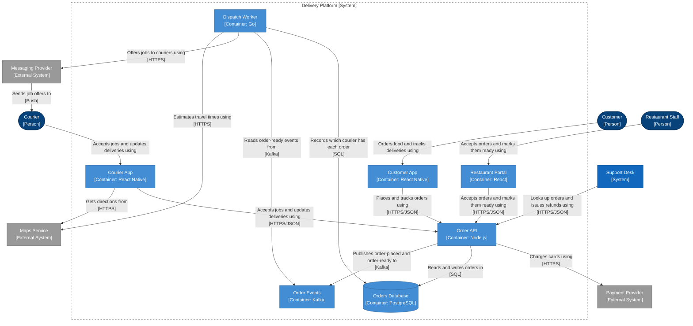

<!-- Generated by open-arch from food-delivery.openarch. Don't edit: change the model in the designer or with the open-arch CLI, and this page is rewritten. -->

# 3. Delivery Platform containers

Container view of [Delivery Platform](../elements/delivery-platform.md).

The apps, services and data stores that make up the Delivery Platform.

## Notes

> A container view looks inside one system. The dashed frame is the Delivery Platform: its containers are inside, and the people and systems they talk to are outside.

> A container is something that runs or stores data on its own: an app, a website, an API, a worker, a database or a queue. Nothing to do with Docker!

> Dashed arrows are implied: the real relationship belongs to something inside the box. The apps actually call the Order Routes component inside the Order API (view 4).

> The cylinder is a database. Anything tagged "database" is drawn that way.

> Boxes and arrows can say what they're built with: [Container: Node.js] on a box, or the protocol under an arrow's description.

## Elements

| Element | Kind | Technology | Description |
|---|---|---|---|
| [Courier](../elements/courier.md) | Person |  | Collects orders from restaurants and delivers them. |
| [Customer](../elements/customer.md) | Person |  | Orders food from local restaurants. |
| [Restaurant Staff](../elements/restaurant-staff.md) | Person |  | Accepts orders and gets them ready for pickup. |
| [Maps Service](../elements/maps-service.md) | External System |  | Provides maps, directions and travel times. |
| [Messaging Provider](../elements/messaging-provider.md) | External System |  | Sends push notifications and text messages. |
| [Payment Provider](../elements/payment-provider.md) | External System |  | Takes card payments. |
| [Support Desk](../elements/support-desk.md) | System |  | Tracks customer problems and refunds. |
| [Courier App](../elements/courier-app.md) | Container | React Native | Shows couriers their jobs and the way there. |
| [Customer App](../elements/customer-app.md) | Container | React Native | Lets customers browse menus, order and track their food. |
| [Dispatch Worker](../elements/dispatch-worker.md) | Container | Go | Finds a nearby courier for every order that's ready. |
| [Order API](../elements/order-api.md) | Container | Node.js | Takes orders, charges for them and tracks their progress. |
| [Order Events](../elements/order-events.md) | Container | Kafka | Carries events like order-placed and order-ready. |
| [Orders Database](../elements/orders-db.md) | Container | PostgreSQL | Stores orders, menus and deliveries. |
| [Restaurant Portal](../elements/restaurant-portal.md) | Container | React | Lets restaurants manage menus and incoming orders. |

## Relationships

| From | To | Description | Technology |
|---|---|---|---|
| [Courier](../elements/courier.md) | [Courier App](../elements/courier-app.md) | Accepts jobs and updates deliveries using |  |
| [Courier App](../elements/courier-app.md) | [Maps Service](../elements/maps-service.md) | Gets directions from | HTTPS |
| [Courier App](../elements/courier-app.md) | [Order API](../elements/order-api.md) | Accepts jobs and updates deliveries using | HTTPS/JSON |
| [Customer](../elements/customer.md) | [Customer App](../elements/customer-app.md) | Orders food and tracks deliveries using |  |
| [Customer App](../elements/customer-app.md) | [Order API](../elements/order-api.md) | Places and tracks orders using | HTTPS/JSON |
| [Dispatch Worker](../elements/dispatch-worker.md) | [Maps Service](../elements/maps-service.md) | Estimates travel times using | HTTPS |
| [Dispatch Worker](../elements/dispatch-worker.md) | [Messaging Provider](../elements/messaging-provider.md) | Offers jobs to couriers using | HTTPS |
| [Dispatch Worker](../elements/dispatch-worker.md) | [Order Events](../elements/order-events.md) | Reads order-ready events from | Kafka |
| [Dispatch Worker](../elements/dispatch-worker.md) | [Orders Database](../elements/orders-db.md) | Records which courier has each order | SQL |
| [Messaging Provider](../elements/messaging-provider.md) | [Courier](../elements/courier.md) | Sends job offers to | Push |
| [Order API](../elements/order-api.md) | [Order Events](../elements/order-events.md) | Publishes order-placed and order-ready to | Kafka |
| [Order API](../elements/order-api.md) | [Orders Database](../elements/orders-db.md) | Reads and writes orders in | SQL |
| [Order API](../elements/order-api.md) | [Payment Provider](../elements/payment-provider.md) | Charges cards using | HTTPS |
| [Restaurant Portal](../elements/restaurant-portal.md) | [Order API](../elements/order-api.md) | Accepts orders and marks them ready using | HTTPS/JSON |
| [Restaurant Staff](../elements/restaurant-staff.md) | [Restaurant Portal](../elements/restaurant-portal.md) | Accepts orders and marks them ready using |  |
| [Support Desk](../elements/support-desk.md) | [Order API](../elements/order-api.md) | Looks up orders and issues refunds using | HTTPS/JSON |

[All views and elements](../README.md)
