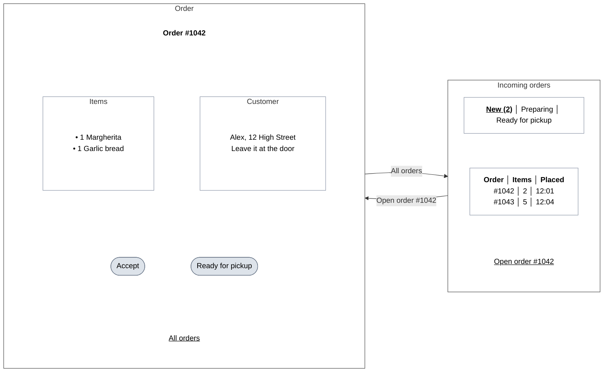

<!-- Generated by open-arch from food-delivery.openarch. Don't edit: change the model in the designer or with the open-arch CLI, and this page is rewritten. -->

# 8. Restaurant Portal screens

Wireframe view of [Restaurant Portal](../elements/restaurant-portal.md).

What restaurant staff see when an order comes in.

## Sticky notes

> The Restaurant Portal is a website that restaurants keep open on a computer, so its screens are drawn for a desktop: wider than the phone screens of view 7.

> Ready for pickup is where the order leaves the restaurant. Behind it, the Dispatch Worker finds a courier: follow the arrows from the Order API in view 3.

## Screens

### 1. Incoming orders

Desktop screen. The screen staff keep open during service.

| # | Widget | Text | Leads to | Description |
|---|---|---|---|---|
| 1 | Tabs | New (2) / Preparing / Ready for pickup |  |  |
| 2 | Table | Order \| Items \| Placed / #1042 \| 2 \| 12:01 / #1043 \| 5 \| 12:04 |  |  |
| 3 | Link | Open order #1042 | Order |  |

### 2. Order

Desktop screen. One order, to accept and make.

| # | Widget | Text | Leads to | Description |
|---|---|---|---|---|
| 1 | Heading | Order #1042 |  |  |
| 2 | Row |  |  |  |
| 2.1 | Panel | Items |  |  |
| 2.1.1 | List | 1 Margherita / 1 Garlic bread |  |  |
| 2.2 | Panel | Customer |  |  |
| 2.2.1 | Text | Alex, 12 High Street / Leave it at the door |  |  |
| 3 | Row |  |  |  |
| 3.1 | Button | Accept |  |  |
| 3.2 | Button | Ready for pickup |  | Tells the Order API, which puts an order-ready event on the queue, and the Dispatch Worker finds a courier. |
| 4 | Link | All orders | Incoming orders |  |

[All views and elements](../README.md)
