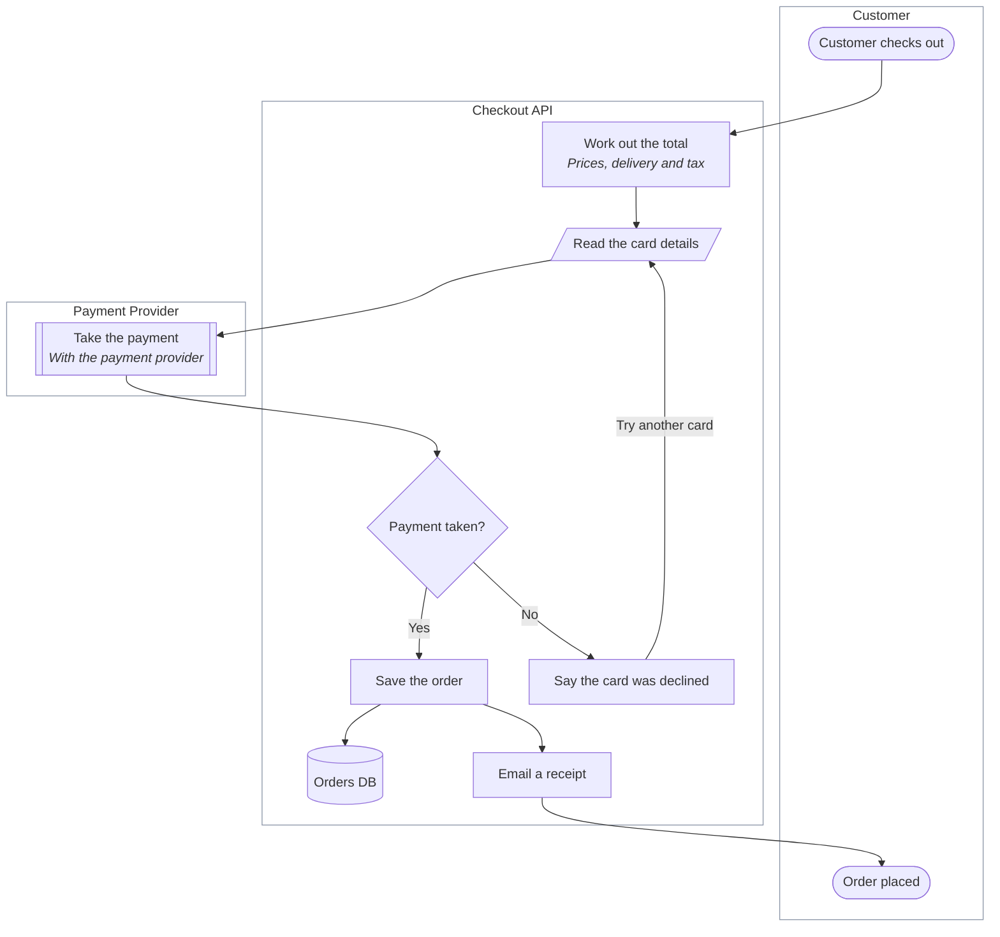

<!-- Generated by open-arch from shop.openarch. Don't edit: change the model in the designer or with the open-arch CLI, and this page is rewritten. -->

# Checking out

Flowchart view of [Checkout API](../elements/checkout-api.md).

What the Checkout API does when a customer places an order, from the cart to a receipt.

## Lanes

| Lane | Description |
|---|---|
| Customer |  |
| Checkout API |  |
| Payment Provider |  |

## Blocks

| # | Block | Kind | Lane | Description |
|---|---|---|---|---|
| 1 | Customer checks out | Start | Customer |  |
| 2 | Work out the total | Process | Checkout API | Prices, delivery and tax |
| 3 | Read the card details | Input or output | Checkout API |  |
| 4 | Take the payment | Subprocess | Payment Provider | With the payment provider |
| 5 | Payment taken? | Decision | Checkout API |  |
| 6 | Say the card was declined | Process | Checkout API |  |
| 7 | Save the order | Process | Checkout API |  |
| 8 | Orders DB | Database | Checkout API |  |
| 9 | Email a receipt | Document | Checkout API |  |
| 10 | Order placed | End | Customer |  |

## Flows

| # | From | To | Text |
|---|---|---|---|
| 1 | Customer checks out | Work out the total |  |
| 2 | Work out the total | Read the card details |  |
| 3 | Read the card details | Take the payment |  |
| 4 | Take the payment | Payment taken? |  |
| 5 | Payment taken? | Save the order | Yes |
| 6 | Payment taken? | Say the card was declined | No |
| 7 | Say the card was declined | Read the card details | Try another card |
| 8 | Save the order | Orders DB |  |
| 9 | Save the order | Email a receipt |  |
| 10 | Email a receipt | Order placed |  |

[All views and elements](../README.md)
