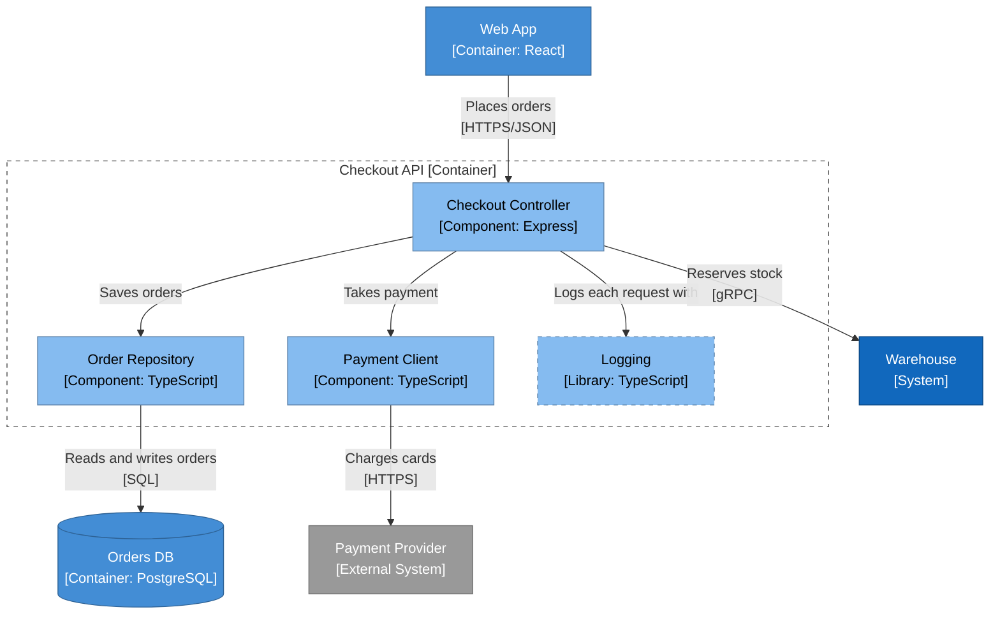

<!-- Generated by open-arch from shop.openarch. Don't edit: change the model in the designer or with the open-arch CLI, and this page is rewritten. -->

# Checkout API components

Component view of [Checkout API](../elements/checkout-api.md).

How a checkout request is handled.

A request from the web app comes in to the Checkout Controller. It reserves stock and takes payment before it saves the order, so every saved order is paid for.

## Elements

| Element | Kind | Technology | Description |
|---|---|---|---|
| [Payment Provider](../elements/payment-provider.md) | External System |  | Takes card payments. |
| [Warehouse](../elements/warehouse.md) | System |  | Tracks stock and ships orders. |
| [Orders DB](../elements/orders-db.md) | Container | PostgreSQL | Stores orders and their status. |
| [Web App](../elements/web-app.md) | Container | React | The storefront customers use. |
| [Checkout Controller](../elements/checkout-controller.md) | Component | Express | Handles checkout requests from the web app. |
| [Order Repository](../elements/order-repository.md) | Component | TypeScript | Reads and writes orders. |
| [Payment Client](../elements/payment-client.md) | Component | TypeScript | Wraps the payment provider's API. |
| [Logging](../elements/logging.md) | Library | TypeScript | Structured logs, written the same way in every part of the shop. |

## Relationships

| From | To | Description | Technology |
|---|---|---|---|
| [Checkout Controller](../elements/checkout-controller.md) | [Logging](../elements/logging.md) | Logs each request with |  |
| [Checkout Controller](../elements/checkout-controller.md) | [Order Repository](../elements/order-repository.md) | Saves orders |  |
| [Checkout Controller](../elements/checkout-controller.md) | [Payment Client](../elements/payment-client.md) | Takes payment |  |
| [Checkout Controller](../elements/checkout-controller.md) | [Warehouse](../elements/warehouse.md) | Reserves stock | gRPC |
| [Order Repository](../elements/order-repository.md) | [Orders DB](../elements/orders-db.md) | Reads and writes orders | SQL |
| [Payment Client](../elements/payment-client.md) | [Payment Provider](../elements/payment-provider.md) | Charges cards | HTTPS |
| [Web App](../elements/web-app.md) | [Checkout Controller](../elements/checkout-controller.md) | Places orders | HTTPS/JSON |

### Payment Client → Payment Provider: Charges cards

Sends the one-time card token the web app got from the provider, never a card number.

Each charge has an idempotency key, so retrying a request can't charge a card twice.

[All views and elements](../README.md)
