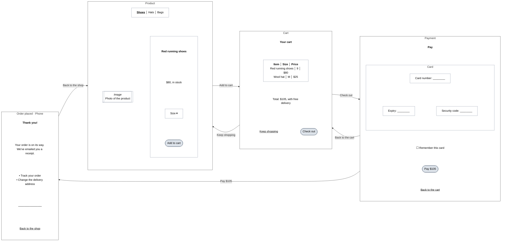

<!-- Generated by open-arch from shop.openarch. Don't edit: change the model in the designer or with the open-arch CLI, and this page is rewritten. -->

# Checkout screens

Wireframe view of [Web App](../elements/web-app.md).

What the customer sees, from a product to a placed order.

## Screens

### 1. Product

Desktop screen. One product, with its price and a button to buy it.

| # | Widget | Text | Leads to | Description |
|---|---|---|---|---|
| 1 | Tabs | Shoes / Hats / Bags |  |  |
| 2 | Row |  |  |  |
| 2.1 | Image | Photo of the product |  |  |
| 2.2 | Panel |  |  |  |
| 2.2.1 | Heading | Red running shoes |  |  |
| 2.2.2 | Text | $80, in stock |  |  |
| 2.2.3 | Drop-down | Size |  |  |
| 2.2.4 | Button | Add to cart | Cart | Reserves nothing yet: stock is reserved when the order is placed. |

### 2. Cart

Desktop screen. What the customer is about to buy.

| # | Widget | Text | Leads to | Description |
|---|---|---|---|---|
| 1 | Heading | Your cart |  |  |
| 2 | Table | Item \| Size \| Price / Red running shoes \| 9 \| $80 / Wool hat \| M \| $25 |  |  |
| 3 | Text | Total: $105, with free delivery |  |  |
| 4 | Row |  |  |  |
| 4.1 | Link | Keep shopping | Product |  |
| 4.2 | Button | Check out | Payment |  |

### 3. Payment

Desktop screen. The card details, which go straight to the payment provider.

| # | Widget | Text | Leads to | Description |
|---|---|---|---|---|
| 1 | Heading | Pay |  |  |
| 2 | Panel | Card |  |  |
| 2.1 | Text field | Card number |  | A field from the payment provider's script, so the card number never reaches the shop. |
| 2.2 | Row |  |  |  |
| 2.2.1 | Text field | Expiry |  |  |
| 2.2.2 | Text field | Security code |  |  |
| 3 | Checkbox | Remember this card |  |  |
| 4 | Button | Pay $105 | Order placed | Places the order: the Checkout API reserves stock, takes payment, then saves it. |
| 5 | Link | Back to the cart | Cart |  |

### 4. Order placed

Phone screen. Also sent as an email.

| # | Widget | Text | Leads to | Description |
|---|---|---|---|---|
| 1 | Heading | Thank you! |  |  |
| 2 | Text | Your order is on its way. We've emailed you a receipt. |  |  |
| 3 | List | Track your order / Change the delivery address |  |  |
| 4 | Divider |  |  |  |
| 5 | Link | Back to the shop | Product |  |

[All views and elements](../README.md)
