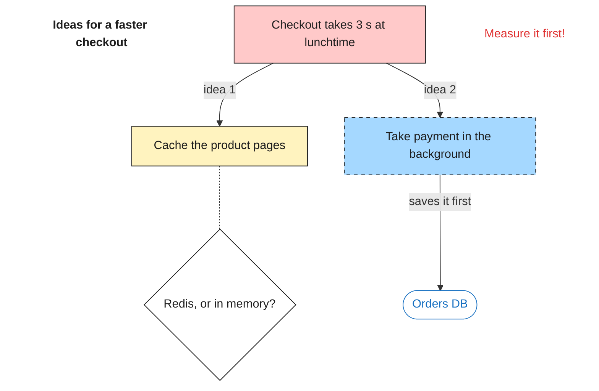

<!-- Generated by open-arch from shop.openarch. Don't edit: change the model in the designer or with the open-arch CLI, and this page is rewritten. -->

# Ideas for a faster checkout

Whiteboard view.

Rough ideas from the checkout retro, to talk through before anything is decided.

## Sticky notes

> Nothing here is decided yet. Once it is, the change goes in the model, and on the container view.

## Shapes

| Shape | Text |
|---|---|
| Text | Ideas for a faster checkout |
| Pen line |  |
| Diamond | Redis, or in memory? |
| Rectangle | Cache the product pages |
| Rectangle | Checkout takes 3 s at lunchtime |
| Rectangle | Take payment in the background |
| Ellipse | Orders DB |
| Text | Measure it first! |

## Arrows

| Arrow | From | To | Text |
|---|---|---|---|
| Arrow | Checkout takes 3 s at lunchtime | Cache the product pages | idea 1 |
| Arrow | Checkout takes 3 s at lunchtime | Take payment in the background | idea 2 |
| Line | Cache the product pages | Redis, or in memory? (its left) |  |
| Arrow | Take payment in the background | Orders DB | saves it first |
| Arrow | the point (80, 186) | Checkout takes 3 s at lunchtime |  |

The diagram above leaves out the line drawn with the pen, and the arrow with an end at a point or on a pen's line, as Mermaid can't draw them. Open the view in the designer to see the whole whiteboard.

[All views and elements](../README.md)
