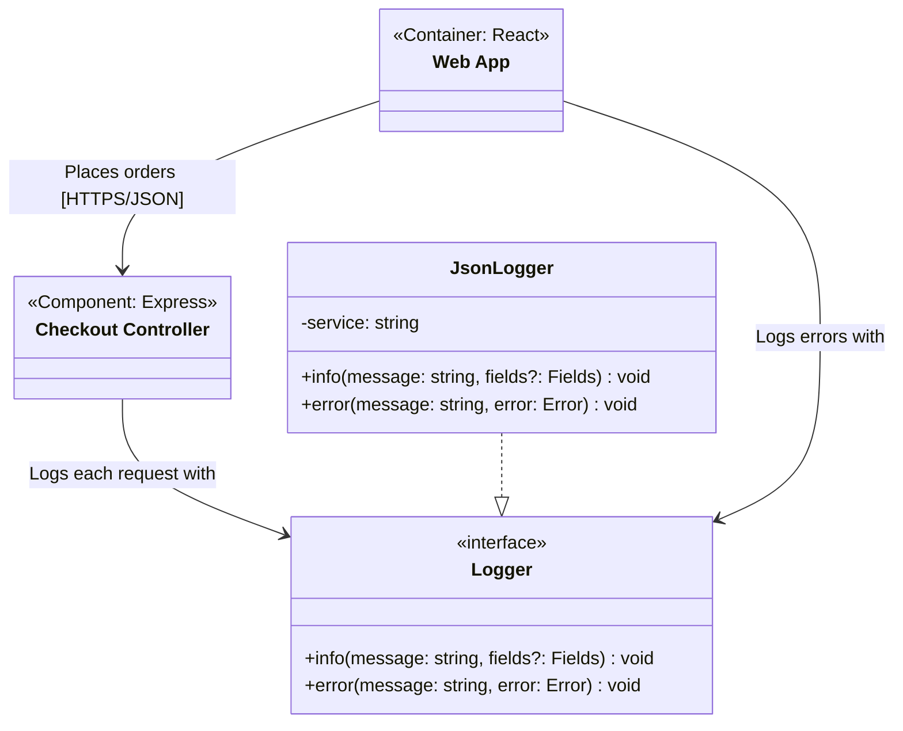

<!-- Generated by open-arch from shop.openarch. Don't edit: change the model in the designer or with the open-arch CLI, and this page is rewritten. -->

# Logging classes

Class view of [Logging](../elements/logging.md).

The shared logging code, and what logs with it.

## Elements

| Element | Kind | Technology | Description |
|---|---|---|---|
| [Web App](../elements/web-app.md) | Container | React | The storefront customers use. |
| [Checkout Controller](../elements/checkout-controller.md) | Component | Express | Handles checkout requests from the web app. |
| [JsonLogger](../elements/json-logger.md) | Class |  | Writes one JSON line per message. |
| [Logger](../elements/logger.md) | Class |  |  |

## Relationships

| From | To | Description | Technology |
|---|---|---|---|
| [Checkout Controller](../elements/checkout-controller.md) | [Logger](../elements/logger.md) | Logs each request with |  |
| [JsonLogger](../elements/json-logger.md) | [Logger](../elements/logger.md) | (realization) |  |
| [Web App](../elements/web-app.md) | [Checkout Controller](../elements/checkout-controller.md) | Places orders | HTTPS/JSON |
| [Web App](../elements/web-app.md) | [Logger](../elements/logger.md) | Logs errors with |  |

[All views and elements](../README.md)
