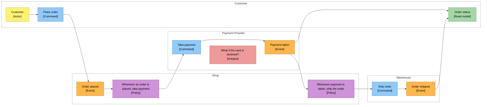

<!-- Generated by open-arch from shop.openarch. Don't edit: change the model in the designer or with the open-arch CLI, and this page is rewritten. -->

# From order to delivery

Event view.

What happens in the business when a customer orders, as an event storm.

## Lanes

| Lane | Description |
|---|---|
| Customer |  |
| Shop |  |
| Payment Provider |  |
| Warehouse |  |

## Cards

| # | Card | Kind | Lane | Comes from | Description |
|---|---|---|---|---|---|
| 1 | Customer | Actor | Customer |  |  |
| 2 | Place order | Command | Customer | Customer |  |
| 3 | Order placed | Event | Shop | Place order |  |
| 4 | Whenever an order is placed, take payment | Policy | Shop | Order placed |  |
| 5 | Take payment | Command | Payment Provider | Whenever an order is placed, take payment |  |
| 6 | What if the card is declined? | Hotspot | Payment Provider |  |  |
| 7 | Payment taken | Event | Payment Provider | Take payment |  |
| 8 | Whenever payment is taken, ship the order | Policy | Shop | Payment taken |  |
| 9 | Ship order | Command | Warehouse | Whenever payment is taken, ship the order |  |
| 10 | Order shipped | Event | Warehouse | Ship order |  |
| 11 | Order status | Read model | Customer | Payment taken, Order shipped | Where the order is, with its tracking link. |

[All views and elements](../README.md)
