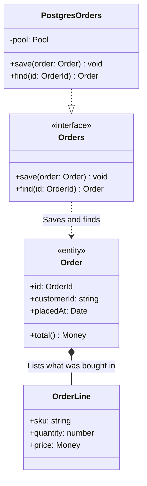

<!-- Generated by open-arch from shop.openarch. Don't edit: change the model in the designer or with the open-arch CLI, and this page is rewritten. -->

# Order Repository classes

Class view of [Order Repository](../elements/order-repository.md).

The classes that store orders, and how they fit together.

## Elements

| Element | Kind | Technology | Description |
|---|---|---|---|
| [Order](../elements/order.md) | Class |  |  |
| [OrderLine](../elements/order-line.md) | Class |  |  |
| [Orders](../elements/orders.md) | Class |  | What the rest of the API needs from a store of orders. |
| [PostgresOrders](../elements/postgres-orders.md) | Class |  | Keeps orders in the Orders DB. |

## Relationships

| From | To | Description | Technology |
|---|---|---|---|
| [Order](../elements/order.md) | [OrderLine](../elements/order-line.md) | (composition) Lists what was bought in |  |
| [Orders](../elements/orders.md) | [Order](../elements/order.md) | (dependency) Saves and finds |  |
| [PostgresOrders](../elements/postgres-orders.md) | [Orders](../elements/orders.md) | (realization) |  |

[All views and elements](../README.md)
