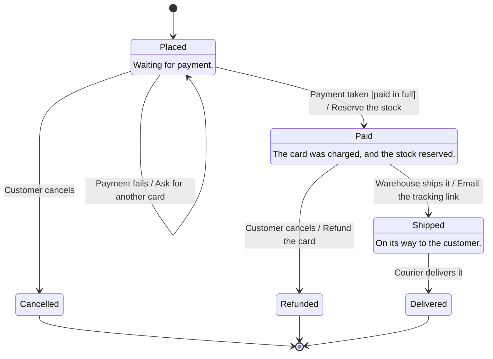

<!-- Generated by open-arch from shop.openarch. Don't edit: change the model in the designer or with the open-arch CLI, and this page is rewritten. -->

# Order states

State view of [Order](../elements/order.md).

What an order goes through, from being placed to being delivered.

## States

| State | Description |
|---|---|
| Placed (starts here) | Waiting for payment. |
| Paid | The card was charged, and the stock reserved. |
| Cancelled (can end here) |  |
| Shipped | On its way to the customer. |
| Refunded (can end here) |  |
| Delivered (can end here) |  |

## Transitions

| # | From | To | Event [guard] / action |
|---|---|---|---|
| 1 | Placed | Paid | Payment taken [paid in full] / Reserve the stock |
| 2 | Placed | Placed | Payment fails / Ask for another card |
| 3 | Placed | Cancelled | Customer cancels |
| 4 | Paid | Shipped | Warehouse ships it / Email the tracking link |
| 5 | Paid | Refunded | Customer cancels / Refund the card |
| 6 | Shipped | Delivered | Courier delivers it |

[All views and elements](../README.md)
