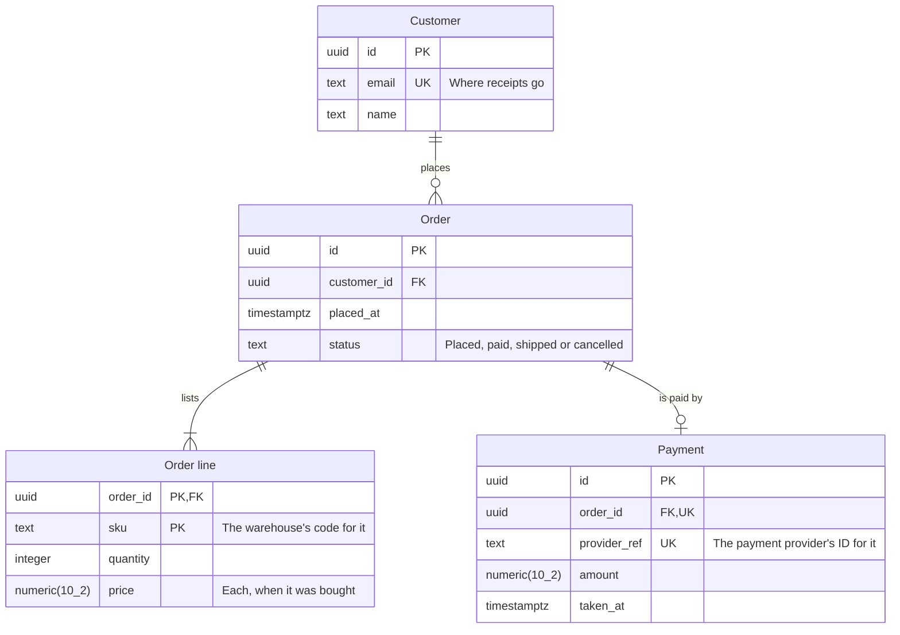

<!-- Generated by open-arch from shop.openarch. Don't edit: change the model in open-arch, and this page is rewritten. -->

# Orders data

Entity view of [Orders DB](../elements/orders-db.md).

What the Orders DB keeps about each order, and who placed it.

## Entities

### Customer

Someone who shops, by their email

| Attribute | Type | Key | Description |
|---|---|---|---|
| id | uuid | PK |  |
| email | text | UK | Where receipts go |
| name | text |  |  |

### Order

One checkout, and where it's got to

| Attribute | Type | Key | Description |
|---|---|---|---|
| id | uuid | PK |  |
| customer_id | uuid | FK |  |
| placed_at | timestamptz |  |  |
| status | text |  | Placed, paid, shipped or cancelled |

### Order line

One thing bought, and how many

| Attribute | Type | Key | Description |
|---|---|---|---|
| order_id | uuid | PK, FK |  |
| sku | text | PK | The warehouse's code for it |
| quantity | integer |  |  |
| price | numeric(10,2) |  | Each, when it was bought |

### Payment

The card payment for an order

| Attribute | Type | Key | Description |
|---|---|---|---|
| id | uuid | PK |  |
| order_id | uuid | FK, UK |  |
| provider_ref | text | UK | The payment provider's ID for it |
| amount | numeric(10,2) |  |  |
| taken_at | timestamptz |  |  |

## Links

| # | From | To | How many | Text |
|---|---|---|---|---|
| 1 | Customer | Order | Exactly one to zero or more | places |
| 2 | Order | Order line | Exactly one to one or more | lists |
| 3 | Order | Payment | Exactly one to zero or one | is paid by |

[All views and elements](../README.md)
