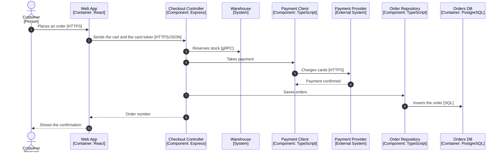

<!-- Generated by open-arch from shop.openarch. Don't edit: change the model in the designer or with the open-arch CLI, and this page is rewritten. -->

# Placing an order

Sequence view.

What happens, in order, when a customer places an order.

Stock is reserved and the card is charged before the order is saved, so every saved order is paid for.

## Elements

| Element | Kind | Technology | Description |
|---|---|---|---|
| [Customer](../elements/customer.md) | Person |  | Someone buying from the shop. |
| [Web App](../elements/web-app.md) | Container | React | The storefront customers use. |
| [Checkout Controller](../elements/checkout-controller.md) | Component | Express | Handles checkout requests from the web app. |
| [Warehouse](../elements/warehouse.md) | System |  | Tracks stock and ships orders. |
| [Payment Client](../elements/payment-client.md) | Component | TypeScript | Wraps the payment provider's API. |
| [Payment Provider](../elements/payment-provider.md) | External System |  | Takes card payments. |
| [Order Repository](../elements/order-repository.md) | Component | TypeScript | Reads and writes orders. |
| [Orders DB](../elements/orders-db.md) | Container | PostgreSQL | Stores orders and their status. |

## Steps

| # | From | To | Description | Technology |
|---|---|---|---|---|
| 1 | [Customer](../elements/customer.md) | [Web App](../elements/web-app.md) | Places an order | HTTPS |
| 2 | [Web App](../elements/web-app.md) | [Checkout Controller](../elements/checkout-controller.md) | Sends the cart and the card token | HTTPS/JSON |
| 3 | [Checkout Controller](../elements/checkout-controller.md) | [Warehouse](../elements/warehouse.md) | Reserves stock | gRPC |
| 4 | [Checkout Controller](../elements/checkout-controller.md) | [Payment Client](../elements/payment-client.md) | Takes payment |  |
| 5 | [Payment Client](../elements/payment-client.md) | [Payment Provider](../elements/payment-provider.md) | Charges cards | HTTPS |
| 6 | [Payment Provider](../elements/payment-provider.md) | [Payment Client](../elements/payment-client.md) | Reply: Payment confirmed |  |
| 7 | [Checkout Controller](../elements/checkout-controller.md) | [Order Repository](../elements/order-repository.md) | Saves orders |  |
| 8 | [Order Repository](../elements/order-repository.md) | [Orders DB](../elements/orders-db.md) | Inserts the order | SQL |
| 9 | [Checkout Controller](../elements/checkout-controller.md) | [Web App](../elements/web-app.md) | Reply: Order number |  |
| 10 | [Web App](../elements/web-app.md) | [Customer](../elements/customer.md) | Reply: Shows the confirmation |  |

### Payment Client → Payment Provider: Charges cards

Sends the one-time card token the web app got from the provider, never a card number.

Each charge has an idempotency key, so retrying a request can't charge a card twice.

[All views and elements](../README.md)
