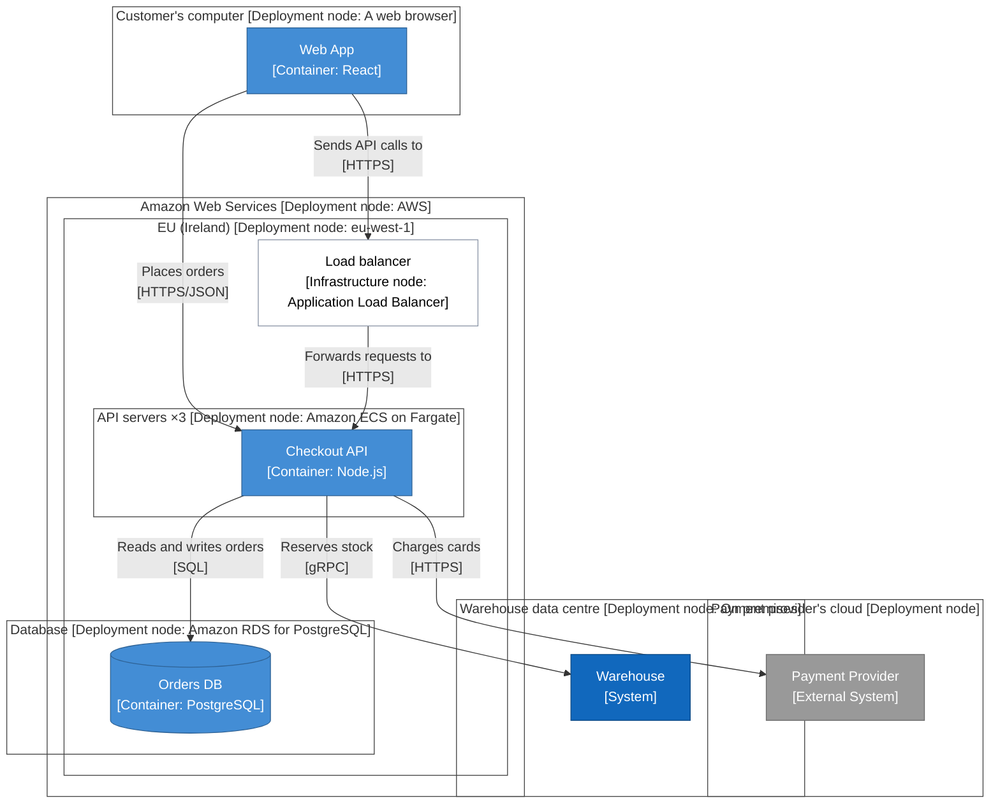

<!-- Generated by open-arch from shop.openarch. Don't edit: change the model in the designer or with the open-arch CLI, and this page is rewritten. -->

# Production

Deployment view.

Where the shop runs for customers.

## Nodes

| Node | Kind | Inside | Technology | Copies | Runs | Description |
|---|---|---|---|---|---|---|
| Amazon Web Services | Deployment node |  | AWS | 1 |  |  |
| EU (Ireland) | Deployment node | Amazon Web Services | eu-west-1 | 1 |  |  |
| API servers | Deployment node | EU (Ireland) | Amazon ECS on Fargate | 3 | [Checkout API](../elements/checkout-api.md) |  |
| Database | Deployment node | EU (Ireland) | Amazon RDS for PostgreSQL | 1 | [Orders DB](../elements/orders-db.md) |  |
| Load balancer | Infrastructure node | EU (Ireland) | Application Load Balancer | 1 |  |  |
| Customer's computer | Deployment node |  | A web browser | 1 | [Web App](../elements/web-app.md) |  |
| Payment provider's cloud | Deployment node |  |  | 1 | [Payment Provider](../elements/payment-provider.md) |  |
| Warehouse data centre | Deployment node |  | On premises | 1 | [Warehouse](../elements/warehouse.md) |  |

## Relationships

| From | To | Description | Technology |
|---|---|---|---|
| [Checkout API](../elements/checkout-api.md) | [Orders DB](../elements/orders-db.md) | Reads and writes orders | SQL |
| [Checkout API](../elements/checkout-api.md) | [Payment Provider](../elements/payment-provider.md) | Charges cards | HTTPS |
| [Checkout API](../elements/checkout-api.md) | [Warehouse](../elements/warehouse.md) | Reserves stock | gRPC |
| [Web App](../elements/web-app.md) | [Checkout API](../elements/checkout-api.md) | Places orders | HTTPS/JSON |

### Payment Client → Payment Provider: Charges cards

Sends the one-time card token the web app got from the provider, never a card number.

Each charge has an idempotency key, so retrying a request can't charge a card twice.

## Connections

| # | From | To | Description | Technology |
|---|---|---|---|---|
| 1 | Load balancer | [Checkout API](../elements/checkout-api.md) | Forwards requests to | HTTPS |
| 2 | [Web App](../elements/web-app.md) | Load balancer | Sends API calls to | HTTPS |

[All views and elements](../README.md)
