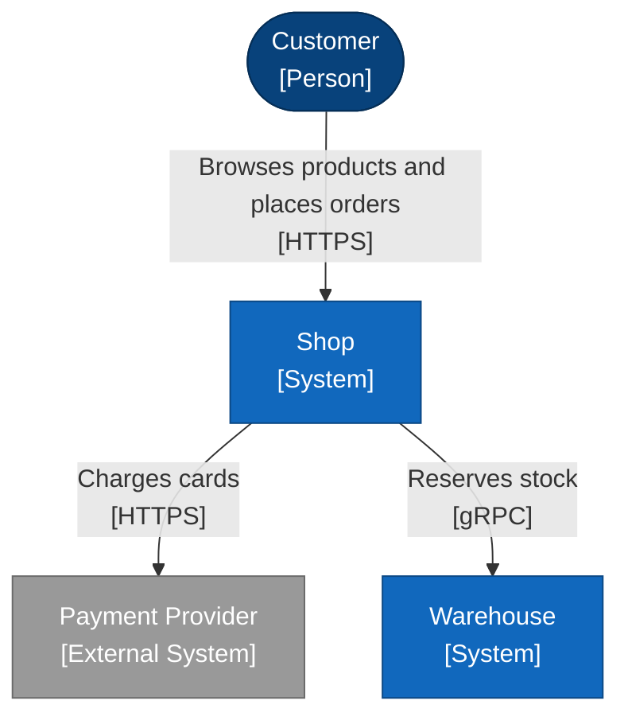

<!-- Generated by open-arch from shop.openarch. Don't edit: change the model in the designer or with the open-arch CLI, and this page is rewritten. -->

# Shop context

Context view of [Shop](../elements/shop.md).

Who uses the shop, and which systems it depends on.

## Elements

| Element | Kind | Technology | Description |
|---|---|---|---|
| [Customer](../elements/customer.md) | Person |  | Someone buying from the shop. |
| [Payment Provider](../elements/payment-provider.md) | External System |  | Takes card payments. |
| [Shop](../elements/shop.md) | System |  | Lets customers browse products and place orders. |
| [Warehouse](../elements/warehouse.md) | System |  | Tracks stock and ships orders. |

## Relationships

| From | To | Description | Technology |
|---|---|---|---|
| [Customer](../elements/customer.md) | [Shop](../elements/shop.md) | Browses products and places orders | HTTPS |
| [Shop](../elements/shop.md) | [Payment Provider](../elements/payment-provider.md) | Charges cards | HTTPS |
| [Shop](../elements/shop.md) | [Warehouse](../elements/warehouse.md) | Reserves stock | gRPC |

[All views and elements](../README.md)
