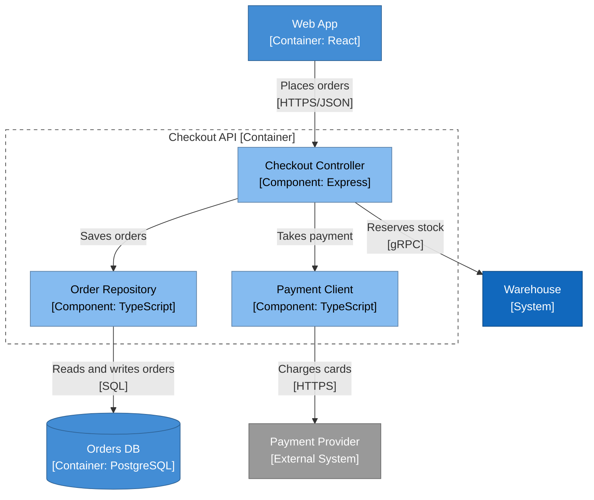

# Checkout API components

How a checkout request is handled.

<!-- open-arch:preview hash=174508f9 — generated from the model by `open-arch fmt`. Don't edit: change the element files instead. -->

<!-- /open-arch:preview -->
