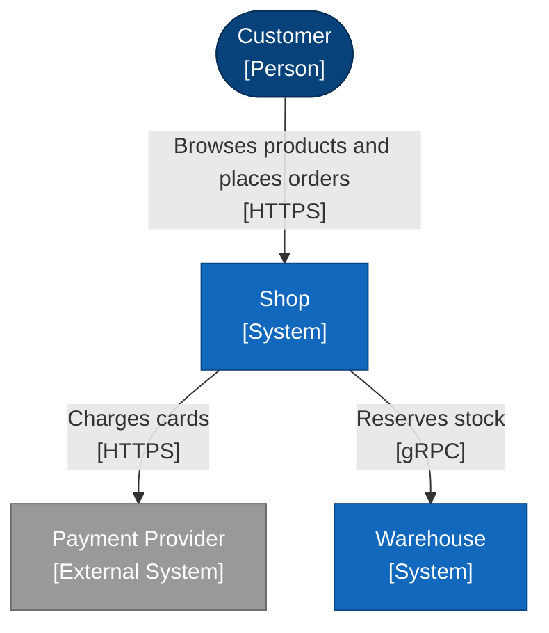

# System landscape

Every person and system, and how they connect.

<!-- open-arch:preview hash=4f221059 — generated from the model by `open-arch fmt`. Don't edit: change the element files instead. -->

<!-- /open-arch:preview -->
