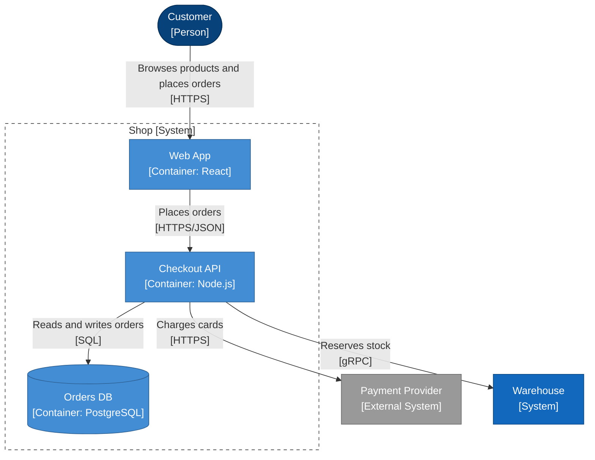

# Shop containers

What runs inside the shop.

<!-- open-arch:preview hash=2c976f44 — generated from the model by `open-arch fmt`. Don't edit: change the element files instead. -->

<!-- /open-arch:preview -->

<!-- open-arch:layout
{
  "nodes": {
    "checkout-api": {"x": 0, "y": 320},
    "customer": {"x": 0, "y": 0},
    "orders-db": {"x": 0, "y": 480},
    "web-app": {"x": 0, "y": 160}
  }
}
-->
